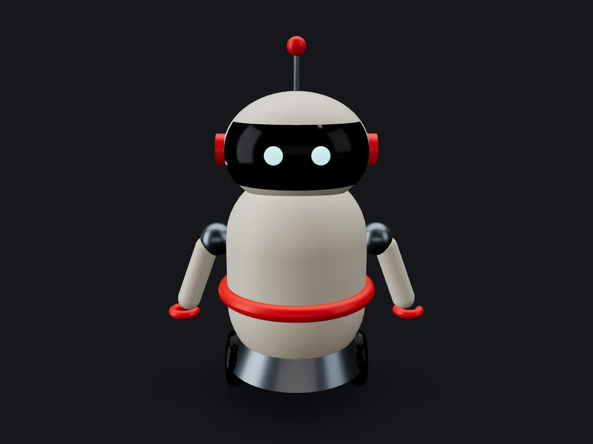

# GLB Configurator

A drag-and-drop **GLB viewer with a mini configurator**, built with **React Three Fiber**, **drei** and **leva**.

**Live URL:** _add your Vercel/Netlify link here_



## What I built

- **Staged 3D scene.** Environment lighting, soft contact shadows and orbit controls (drag/touch to rotate, pinch/scroll to zoom). Any model is **auto-centred and auto-scaled to fit** using drei's `<Stage>`.
- **Drag-and-drop loading.** Drop any `.glb` anywhere on the page, or use the **Upload .glb** button (mobile has no drag-and-drop). Bad files show an error and fall back to the default model.
- **Configurator panel (leva):**
  - pick any **material found in the model**, or just **tap a part** of the model to select its material (it glows briefly)
  - **color, metalness, roughness** for that material, plus **reset materials**
  - **wireframe** toggle, **environment preset**, **auto-rotate speed**, shadows on/off, background colour
- **Default model preloaded.** A small toy robot, so the page is never empty. It is generated from code in `scripts/build-model.mjs` and compressed with meshopt.

## Run it locally

```bash
npm install
npm run dev          # http://localhost:5173
npm run build        # production build → dist/
npm run preview      # serve the production build
```

Useful URL flags while testing:

| Flag | What it does |
|---|---|
| `?static` | force the static fallback (simulates reduced-motion / low-power) |
| `?3d` | force the 3D scene even if the device looks low-power |
| `?debug` | show an FPS / ms / memory meter (for the FE-10 measurement) |

**Use your own default model:**

```bash
npx @gltf-transform/cli optimize my-model.glb public/models/robot.glb --compress meshopt
```

## Deploy

Push to GitHub, then import the repo in **Vercel** or **Netlify**. Use the Vite preset: build command `npm run build`, output folder `dist`.

## Perf note

**Model:** generated robot **452 KB raw → 92 KB** (≈40 KB over the wire gzipped) with `gltf-transform` quantization + **meshopt** compression. `useGLTF` decodes meshopt itself, so no decoder needs to be downloaded from a CDN.

**Bundle:**

| Chunk | Size (min) | gzip | When it loads |
|---|---|---|---|
| `index.js`: React shell + poster | 146 KB | **48 KB** | immediately |
| `Experience.js`: three + R3F + drei + leva | 1.26 MB | **356 KB** | lazily, after first paint, only on capable devices |
| `poster.webp` | 13 KB | n/a | immediately (preloaded, it's the LCP element) |

**What I did to keep it sane:**

- **Lazy canvas.** The entire 3D stack is a `React.lazy()` chunk requested on `requestIdleCallback`, so it never blocks first paint. The poster image is the LCP element.
- **Static fallback.** `prefers-reduced-motion`, Save-Data, ≤2 GB RAM, ≤2 CPU cores or no WebGL all get the poster and **never download the 3D chunk**. There is a "Load interactive 3D anyway" button. Reduced-motion users who opt in get auto-rotate off.
- **Render on demand.** `frameloop="demand"` whenever auto-rotate is 0, so the GPU idles when nothing moves.
- **Capped pixel ratio.** `dpr` is capped at 2 (1.5 on touch devices), and a `<PerformanceMonitor>` drops it to 1 if the frame rate declines.
- **Cheap lighting.** The default "Studio" environment is built from a few Lightformers into a 256px cube map: **zero HDRI downloads**. Other presets stream a 1–2 MB HDRI from the drei CDN only when picked.
- **Cheap shadows.** Contact shadows instead of shadow-mapped lights; they settle after 100 frames.

### FE-10 lens

Measured with `npm run preview` in headless Chrome, mobile viewport, **"Slow 4G" (1.6 Mbps, 150 ms RTT) + 4× CPU throttle**, cache disabled:

| Scenario | LCP | 3D interactive | Transferred |
|---|---|---|---|
| Capable device (3D) | **0.88 s** | 6.6 s | 500 KB |
| Static fallback | **0.85 s** | n/a | **62 KB** |

**Load impact:** adding 3D doesn't hurt LCP, because the poster paints first and the 3D chunk streams in behind it. The cost is about 440 KB extra transfer (mostly three.js) and roughly 6 s on a slow phone before the scene can be interacted with.

**Frame rate:** open the live URL with `?debug` and fill in from real devices:

| Device | FPS (auto-rotate on) | FPS (idle, demand mode) |
|---|---|---|
| Laptop | _…_ | 0 (no frames rendered) |
| Phone | _…_ | 0 |

## What I'd add with more time

- **Shareable configs.** Encode material edits in the URL so a configuration can be sent as a link.
- **Screenshot / export.** Download a PNG of the current view, or export the edited model as a GLB.
- **Part swapping.** Toggle visibility of nodes, or swap variants (`KHR_materials_variants`).
- **Smaller 3D chunk.** Replace drei barrel imports and leva with a lighter custom UI. Load the leva panel in its own chunk.
- **Draco + KTX2 textures** for heavier user models, and a file-size warning for huge drops.
- **AR view on mobile** (`<model-viewer>` / WebXR).

## Project structure

```
src/
  App.jsx              shell: decides poster vs 3D, lazy-loads the 3D chunk
  useCapabilities.js   reduced-motion / low-power / WebGL detection
  ui/Poster.jsx        static fallback (also the loading placeholder)
  three/Experience.jsx Canvas, leva configurator, drag-and-drop, upload
  three/Model.jsx      GLB loading, material discovery, tap-to-select, wireframe
  three/Lighting.jsx   offline studio env + optional HDRI presets
  styles.css
scripts/build-model.mjs  generates + compresses the default robot
public/models/robot.glb  shipped default model (92 KB)
public/poster.webp       static fallback image (13 KB)
```
